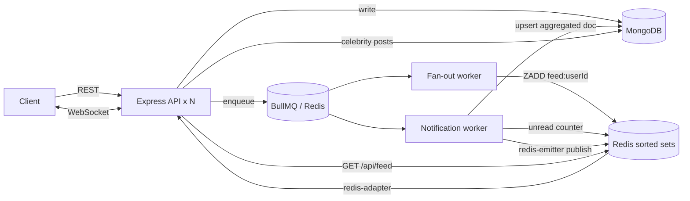

# Social Media Platform: Feed & Notifications (backend)

Node.js · Express · MongoDB (Mongoose) · Redis · BullMQ · Socket.io

A social backend built around the two genuinely hard problems: **feed generation at scale** and **reliable real-time notifications**.
Everything below is implemented in this repo; benchmark numbers are for you to generate on your machine (see *Proof*).

## Run it

```bash
# Option A: everything in Docker (2 API instances + 1 worker + Mongo + Redis)
docker compose up --build
# API:     http://localhost:4000   and  http://localhost:4001
# Swagger: http://localhost:4000/docs
# Demo:    http://localhost:4000/demo.html   (open :4001/demo.html in a second window)

# Option B: local
cp .env.example .env          # needs Mongo + Redis running locally
npm install
npm run dev
```

The web app supports photo posts with up to five images, captions, likes, comments, searchable profiles, follow requests, and follows. Click a creator's name to view their profile and posts. Without `CLOUDINARY_URL`, uploaded photos are saved locally in `data/uploads/` for development. Set `CLOUDINARY_URL` to store and deliver images through Cloudinary; Docker shares its local uploads volume between API instances.

Demo script (90 seconds): open the demo page, click **Log in** on both panels, make Bob follow `alice_demo`, let Alice post,
then Bob likes it. Alice's badge increments live, and further likes **aggregate** into one notification ("bob_demo and 12 others liked your post").
With `docker compose`, load Alice on `:4000` and Bob on `:4001`: delivery crosses API instances through Redis.

## Architecture



**Write path (new post):** insert post → enqueue `fanout-post` → worker pushes the post id into each follower's Redis sorted set `feed:{userId}`
(score = createdAt ms, trimmed to the newest `FEED_MAX_LEN`).
**Read path (`GET /api/feed`):** read the user's sorted set, pull posts from followed *celebrities* from Mongo, merge by `(createdAt, _id)`,
hydrate with a single aggregation (`$lookup` author + `$lookup` viewer's like), return `nextCursor`.
**Notification path:** like/comment/follow → enqueue → worker upserts one aggregated document → increments Redis unread counter → publishes `notification:new` through `@socket.io/redis-emitter` → whichever API instance holds the user's socket delivers it.

## Design decisions & trade-offs

| Decision | Why | Cost / alternative |
|---|---|---|
| **Hybrid fan-out** (write for normal users, read for accounts with ≥ `CELEB_THRESHOLD` followers) | A 1M-follower post under pure fan-out-on-write = 1M Redis writes per post. Pure fan-out-on-read makes every feed load an N-author query. Hybrid caps both. | Two code paths to keep consistent; threshold needs tuning. Posts from an account that crosses the threshold are de-duplicated at merge time. |
| **Compound cursor `(createdAt, _id)`** | Offset pagination skips/duplicates items when the feed changes under you, and gets slower with depth. Timestamp-only cursors break on ties. | Opaque cursor; no "jump to page 7". |
| **Redis sorted set per user, capped** | O(log n) reads, bounded memory (`FEED_MAX_LEN` entries/user). | Older history falls back to the Mongo path / rebuild. Deleted posts are dropped lazily at hydration. |
| **Counters stored on the document (`likeCount`)** with atomic `$inc`, only after the unique `Like` insert succeeds | Counting a collection per read is O(likes). Unique index makes likes idempotent; `$inc` avoids lost updates. | Counter can drift if the process dies between the two writes; a reconciliation job would fix it. For hot posts, move counters to Redis and flush periodically. |
| **Notification aggregation** via one upsert per `(user, type, entity)` while unread, guarded by a *partial unique index* | "A and 12 others liked your post" instead of 13 rows; concurrent workers cannot create duplicates (loser retries via BullMQ). | Count includes re-likes after an unlike. Unread = number of documents, not events. |
| **Redis adapter + emitter** | Sockets work across API instances and the worker can push events without owning any socket. | Redis is a hard dependency for real-time. |
| **Follow-request accept = atomic conditional update**, not a transaction | `findOneAndUpdate({status:'pending'}, …)` has exactly one winner, so counters change once. Works on a standalone Mongo (no replica set). | Multi-step workflows that must be all-or-nothing would need real transactions. Tested with concurrent accepts. |
| **Refresh-token rotation with reuse detection** | A stolen refresh token is single-use; replaying one revokes all of that user's sessions. | Needs Redis state per session. |
| **BullMQ for fan-out + notifications** | HTTP latency is independent of follower count; retries with backoff; separate worker process scales independently. | Eventual consistency: a post appears in followers' feeds milliseconds later, not in the same transaction. |

## Proof (generate your own numbers)

```bash
docker compose up -d mongo redis
npm install
npm run seed -- --reset                       # 20k users, ~600k follows, ~200k posts
# bigger:  SEED_USERS=100000 SEED_POSTS_PER_USER=10 npm run seed -- --reset   (~1M posts)

npm run explain                               # shows IXSCAN stages + docs examined for the hot queries

RATE_LIMIT_DISABLED=true npm start            # terminal 1
BENCH_EMAIL=user1000@example.com npm run bench   # terminal 2: autocannon, prints a markdown table
```

Paste the table here after running it:

| Strategy | req/s | p50 (ms) | p97.5 (ms) | p99 (ms) | errors |
|---|---|---|---|---|---|
| Mongo only (fan-out on read) | _run it_ | | | | |
| Hybrid (Redis push + celeb pull) | _run it_ | | | | |

Seeded accounts follow a power-law, so `user0` ends up with far more than 10k followers and exercises the fan-out-on-read path.

## Tests & CI

`npm test` (Node's built-in runner + supertest; needs Mongo and Redis, using DB `socialfeed_test` and Redis db 1). Covers: refresh-token reuse detection, idempotent follow/like (including concurrent likes),
cursor pagination with no gaps/duplicates across 25 same-ms posts, hybrid vs Mongo strategy parity, notification aggregation + unread counts, and exactly-once concurrent follow-request accepts.
GitHub Actions workflow in `.github/workflows/ci.yml` runs it against Mongo and Redis service containers.

## API summary (full spec at `/docs`)

| Area | Endpoints |
|---|---|
| Auth | `POST /api/auth/register · login · refresh · logout`, `GET /api/auth/me` |
| Feed | `GET /api/feed?cursor=&limit=10` |
| Posts | `POST /api/posts` (JSON `mediaUrls` or multipart `images`, up to 5) · `GET/DELETE /api/posts/:id` · `POST/DELETE /api/posts/:id/like` · `…/save` · `GET /api/posts/saved` · `POST /api/posts/:id/report` |
| Comments | `POST/GET /api/posts/:id/comments` (with `parentId` for replies, `@mentions` notify) · `DELETE /api/posts/:postId/comments/:commentId` |
| Social graph | `POST/DELETE /api/users/:id/follow` · `GET /api/users/:username/followers\|following` · `GET /api/follow-requests` · `PATCH /api/follow-requests/:id/accept\|reject` · `POST/DELETE /api/users/:id/block` · `GET /api/users/suggested` |
| Profiles | `GET /api/users/:username` · `GET /api/users/:username/posts` · `GET /api/users/me/analytics?period=1d\|7d\|30d` · `PATCH /api/users/me` |
| Notifications | `GET /api/notifications?cursor=` · `GET …/unread-count` · `PATCH …/read-all` · `PATCH …/:id/read` |
| Explore | `GET /api/explore/trending` · `GET /api/search?q=&type=user\|post\|hashtag` |
| Socket events | server → client: `notification:new`, `post:liked`, `comment:new` · client → server: `post:watch`, `post:unwatch` |

## Production notes

- Zod validation on every input · Helmet · Redis-backed tiered rate limits (global / auth / write) shared across instances · max page size 50.
- pino structured logs · `/health` checks Mongo and Redis · graceful shutdown.
- Media: set `CLOUDINARY_URL` to enable multipart image upload; serve with `f_auto,q_auto` URL transforms and a responsive `srcset` on the frontend.
- Deploy: backend on Render/Railway/Fly.io (WebSocket support), MongoDB Atlas, Upstash Redis (use the TCP `rediss://` URL, which BullMQ requires). Run the worker as a second service (`npm run worker`, `RUN_WORKER=false` on the API).
- Add Sentry (`@sentry/node`) and UptimeRobot on `/health` for monitoring.

## Stretch goals (not implemented)

Stories with TTL indexes · algorithmic ranking · Redis hot counters flushed to Mongo · moderation API · FCM push.
